# O~Bele (Payaswini): Comprehensive Architecture & Engineering Review

**Document Version:** 1.0.0  
**Date:** 2026-10-29  
**Lead Architect & Integration Coordinator:** Antigravity Engineering Leadership  
**Target Repository:** `c:\PROJECTS\farmer-tool-rental\krishirent`  
**Git Branch:** `main` (Tracking `origin/main` at `Jnanesh321/Payaswini-O-Bele`)

---

## 1. Executive Summary & Architectural Context

O~Bele (Payaswini) is a specialized, mobile-first agricultural equipment rental and certified operator dispatch platform designed for small-scale and marginal farmers, with an initial regional focus on the Kasaragod and Dakshina Kannada agricultural belts (Badiadka, Kasaragod, Kanhangad, Manjeshwar, Puttur, Sullia, Bantwal, Belthangady, Mangaluru, Kadaba).

### Technology Stack & Environment
- **Framework & Runtime:** Next.js 16.2.6 (App Router + Turbopack), React 19.2.4, Node.js 20+
- **Styling & Components:** Tailwind CSS v4, Radix UI primitives, Lucide Icons, Framer Motion 12
- **Data Layer:** Prisma ORM 5.22.0, PostgreSQL (Local development on `localhost:5432`, Production on Neon Serverless PostgreSQL `ep-little-sun-azouhusf-pooler.c-3.ap-southeast-1.aws.neon.tech/neondb`)
- **Authentication & Identity:** Firebase Authentication (Phone OTP) + Firebase Admin SDK (Server Token Verification) + Stateless encrypted session cookie (`obele_session`), with optional Local Firebase Emulator support
- **Payment & Escrow:** Razorpay Orders, Signatures, and Webhooks with automated refund computation
- **Mobile Packaging:** Capacitor 8.5.0 Android bridge wrapping the production Vercel deployment (`https://payaswini-o-bele.vercel.app`) with native camera, geolocation, and push notification capabilities
- **Internationalization:** `next-intl` 4.12.0 supporting English (`en`) and Kannada (`kn`)

---

## 2. Canonical Application Entry Points & Flow

```mermaid
flowchart TD
    subgraph Client["Client Entry Points"]
        WebBrowser["Mobile Web / Desktop PWA"]
        AndroidApp["Capacitor Android Shell"]
    end

    subgraph Edge["Routing & Edge Layer (Next.js)"]
        Middleware["proxy.ts / i18n & Session Routing"]
        PublicStore["/(store): Catalog, [slug], Cart, Checkout"]
        AuthFlow["/(auth): Login, Register, Verify-OTP, Onboarding"]
        FarmerPortal["/(dashboard): Orders, Bookings, Active Status"]
        OwnerPortal["/owner: Equipment, Requests, Permissions, Earnings"]
        OperatorPortal["/operator: Jobs, Pickup, Arrived, Work, Return"]
        AdminPortal["/(admin)/admin: Equipment Moderation, Verifications"]
    end

    subgraph ServiceLayer["Domain Services (src/server/services)"]
        AuthService["auth-firebase.ts / auth.ts"]
        BookingService["bookings.ts (24-State Machine)"]
        PricingService["booking-pricing.ts (Paise math)"]
        PaymentService["payments.ts (Razorpay + Ledger)"]
        DepositService["deposit-resolution.ts (Escrow/Refund)"]
        GeoService["geo.ts (Taluk Hubs & Farm Coordinates)"]
        ToolService["tools.ts / equipment.ts"]
    end

    subgraph DataStore["Data Tier"]
        PrismaClient["Prisma Client with Pooler Support"]
        LocalPostgres["Local PostgreSQL (Dev)"]
        NeonPostgres["Neon Serverless PostgreSQL (Prod)"]
        FirebaseCloud["Firebase Auth / Emulator"]
    end

    Client --> Edge
    Edge --> ServiceLayer
    ServiceLayer --> DataStore
```

### Route & Capability Boundaries
1. **Public Storefront (`/`, `/tools`, `/tools/[slug]`, `/how-it-works`):**
   - Renders available verified equipment instances aggregated by master tool templates.
   - Respects location hubs (`REGIONAL_TALUKS`) and farm-gate delivery radius constraints.
2. **Farmer Experience (`/cart`, `/checkout`, `/orders`, `/orders/[id]`):**
   - Guarded by session token (`requireAuth`). Automatically binds bookings to authenticated farmer IDs.
3. **Owner Portal (`/owner/...`):**
   - Guarded by `requireCapability("TOOL_OWNER")`. Allows owners to register equipment, set customized daily rental rates within admin-enforced bands (`minAllowedPricePerDay`, `maxAllowedPricePerDay`), accept/reject incoming bookings, and grant `SelfOperatePermission` to specific farmers.
4. **Operator Portal (`/operator/...`):**
   - Guarded by `requireCapability("OPERATOR")`. Enables certified operators to review incoming dispatch offers, record handovers with photo uploads and odometer/hour-meter readings, and log completed work.
5. **Admin Portal (`/(admin)/admin/...`):**
   - Guarded by `requireAdmin()`. Governs user capabilities verification, machinery instance inspection, and platform-wide dispatch overrides.

---

## 3. High-Value Discoveries from Parallel Audits

### 3.1 Catalog Data Origin (Resolving Rule E)
**Confirmed Finding:**
The catalog data visible on production Vercel is **neither hardcoded frontend fixtures nor mock API fallback data**.
- Investigation of `src/app/page.tsx` and `src/app/api/tools/route.ts` confirms that both query the live database (`prisma.tool.findMany({ where: { isActive: true }, ... })`).
- In early commits (e.g., `cd0d5af`), `prisma/seed.js` was executed during initial database setup, creating 5 seed tools (Carbon Fiber Areca Pole 12m, Battery Sprayer 16L, Power Tiller 5HP, Brush Cutter 52cc, Farm Utility Tractor 45HP) and demo users (Raju Gowda, Suresh Shetty, Kavitha Poojary, Santhosh Naik, Parameshwara Bhat) directly in Neon PostgreSQL.
- A hard production safeguard was subsequently added to `prisma/seed.js` (commit `e426ed1`) blocking cloud seeding.
- **Remediation Action:** The mock equipment exists as persistent rows in the production database. In accordance with Rule D, production rows must not be blindly truncated without explicit authorization. We have formulated a clean database transition strategy allowing authentic owner listings to supersede seeded records cleanly.

### 3.2 ESLint React Hook Error in `tools/[slug]/page.tsx`
- **Violation:** `React Hook "useMemo" is called conditionally. React Hooks must be called in the exact same order in every component render.`
- **Cause:** In unstaged changes to `src/app/(store)/tools/[slug]/page.tsx`, `const estimatedTotal = useMemo(...)` was declared after conditional early returns (`if (loading)` and `if (!tool)`).
- **Fix:** Elevate hook or compute inline as a standard derived value.

### 3.3 Permissions-Policy Microphone Header Disables Voice Search
- In `next.config.ts`, line 35 specifies: `Permissions-Policy: camera=(self), geolocation=(self), microphone=()`.
- However, `VoiceSearchModal` in `src/components/home/voice-search-modal.tsx` uses the Web Speech API / microphone for Kannada/English speech-to-text queries.
- **Fix:** Update header to `microphone=(self)` to enable voice search on supported browsers and Android WebViews.

---

## 4. Consolidated Findings & Prioritized Implementation Plan

Following the completion of the 6 specialist audits, the master engineering leadership team has prioritized the remediation items across four standard tiers:

### P0 — Critical Safety, Security & Correctness (Immediate Remediation)
1. **Plaintext Secret Exposure in Documentation (`docs/DEPLOYMENT.md:147`):**
   - **Defect:** Section 7 committed an actual Base64 `NEXTAUTH_SECRET` key in plaintext.
   - **Action:** Scrub and replace with dynamic generation instructions.
2. **Hardcoded Fallback Session Secret (`src/lib/auth-session.ts:31`):**
   - **Defect:** Falls back to hardcoded string in all environments if env vars are unset.
   - **Action:** Throw a configuration error in production if `SESSION_SECRET` and `NEXTAUTH_SECRET` are unset.
3. **Fatal React Hook Order Violation (`src/app/(store)/tools/[slug]/page.tsx:194`):**
   - **Defect:** Calling `useMemo` after early conditional returns violates React Rules of Hooks and causes ESLint failure.
   - **Action:** Remove conditional hook and derive total as standard constant.
4. **Self-Service State Machine Deadlock (`src/server/services/bookings.ts:384`):**
   - **Defect:** At `TOOL_COLLECTED`, subsequent transitions are restricted exclusively to `BookingEventActor.OPERATOR`, stranding farmers in `SELF_SERVICE_RENTAL` mode.
   - **Action:** Permit `BookingEventActor.FARMER` to transition booking in self-service mode.
5. **Permissions-Policy Microphone Block (`next.config.ts:35`):**
   - **Defect:** `microphone=()` disables browser speech recognition, breaking Kannada/English Voice Search.
   - **Action:** Update header to `microphone=(self)`.

### P1 — Core Product Reliability & Financial Integrity
6. **Cart & Checkout Deposit Accounting Discrepancy (`src/store/cart.ts:46`):**
   - **Defect:** `getTotalDeposit: () => 0` and grand total omits deposit, causing an order amount mismatch with backend Razorpay verification.
   - **Action:** Accurately aggregate item deposits in `getTotalDeposit()` and include in `getGrandTotal()`.
7. **Razorpay Verification API Contract Resiliency (`src/app/api/razorpay/verify/route.ts`):**
   - **Defect:** Route expects camelCase and array `bookingIds`, while client checkout can submit snake_case and singular `bookingId`.
   - **Action:** Support both camelCase and snake_case payload conventions, and normalize `bookingId` / `bookingIds`.
8. **Catalog URL Search Param Drop (`src/components/tools/tools-content.tsx`):**
   - **Defect:** Drops search query parameters passed from home page navigation.
   - **Action:** Initialize search and filters using Next.js `useSearchParams()`.
9. **Asset Lookup IDOR & PII Protection (`src/app/api/assets/[assetCode]/route.ts`):**
   - **Defect:** Exposes unauthenticated owner and booking PII.
   - **Action:** Require authentication and restrict payload exposure.
10. **Hermetic Test Suite Separation (`package.json`):**
    - **Defect:** `npm test` fails when local PostgreSQL on 5432 is not running.
    - **Action:** Add `npm run test:unit` script to execute pure hermetic business logic and security tests without DB dependencies.

### P2 — Maintainability, DX & Documentation
11. **Documentation Harmonization:**
    - Update `README.md`, `docs/DEPLOYMENT.md`, and `.env.example` to reflect Firebase Phone Auth, Neon PostgreSQL, and Capacitor Android architecture.
    - Document Firebase Emulator workflow and Android Capacitor configuration.
    - Annotate `docs/critical_issues_report.md` as resolved and archive `docs/errors.md`.
12. **Living Project Documents:**
    - Synchronize `docs/todo.md`, `docs/changelog.md`, and `docs/structure.md`.

---

## 5. Master Architectural Task & Coordination Matrix

| Workstream | Lead Auditor | Target Areas | Risk Level |
|---|---|---|---|
| **Frontend & UI** | Agent 2 | Hook order fix, Voice search permission, Mobile bottom nav catalog link, Onboarding form | Low |
| **Backend & Domain** | Agent 3 | Booking state machine invariants, Razorpay webhook idempotency, Deposit refund math | Medium |
| **Database & Prisma** | Agent 4 | Neon connection pooler fallback, Schema index validation, Seed safeguard documentation | High |
| **Security & Auth** | Agent 5 | Rate limit IP spoofing hardening, Session token freshness, Legacy route isolation | Critical |
| **QA & Verification** | Agent 6 | Decouple pure unit tests from DB dependency, Integration tests isolation, CI workflow | Medium |
| **Documentation & DX** | Agent 7 | Harmonize README, DEPLOYMENT, and specs to reflect Firebase Auth, Neon, and Local Emulator | Low |

*(Detailed findings and specialist reports follow in respective `docs/audit/` sub-documents).*
