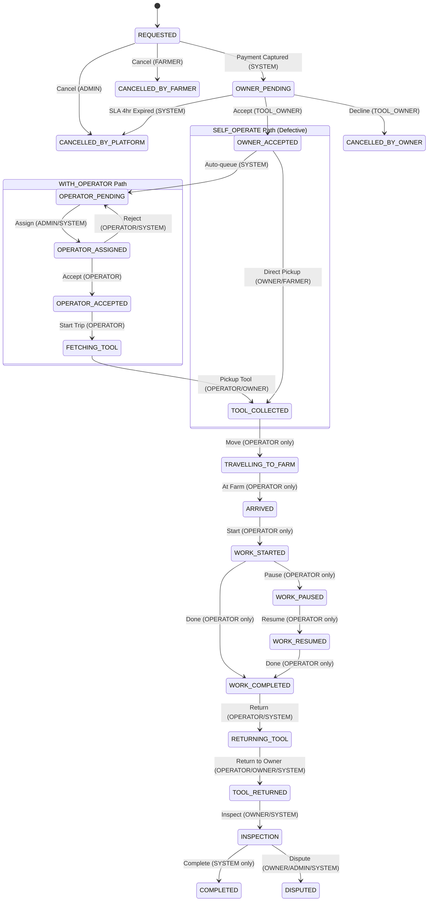

# Backend and Domain Logic Audit Report: O~Bele (Payaswini Farmer Tool Rental)

**Audit Scope:** Route Handlers (`src/app/api/...`), Server Actions, Domain Services (`src/server/services/`), Domain Libraries (`src/server/lib/`, `src/lib/`), Booking State Machine (24 States), Financial & Deposit Engine, Payment Reconciliation, Geospatial Dispatch, Concurrency & Locking, Error Handling, and Security Boundaries.  
**Target Environment:** Node.js / Next.js App Router, Prisma ORM, PostgreSQL, Razorpay SDK, Firebase Auth, MSG91/Fast2SMS.  
**Auditor:** Specialist Agent 3 (Backend and Domain Logic Auditor)  
**Date:** October 2026  

---

## Executive Summary

This audit conducted an exhaustive line-by-line inspection of the backend services, domain logic, and API routes of the O~Bele agricultural equipment rental platform. While foundational architectural decisions (such as server-authoritative pricing in `booking-pricing.ts`, state logging in `booking_state_logs`, and conditional idempotency claims in `deposit-resolution.ts`) reflect sound domain intent, the audit confirmed several **critical architectural breaks, contract mismatches, and logic flaws** that actively break core user workflows in production.

Most critically:
1. **Self-service tool rentals are trapped in a state machine deadlock** at `TOOL_COLLECTED`, because all subsequent operational transitions are restricted exclusively to `BookingEventActor.OPERATOR`, leaving farmers unable to start or return rented equipment.
2. **Terminal cancellations and SLA timeouts record "REFUNDED" status in the database but never trigger Razorpay refunds** ("ghost refunds"), notifying farmers of refunds that were never dispatched to the payment gateway.
3. **The frontend checkout and payment verification contracts are broken** due to field name mismatches (`deliveryAddress` vs `address`, and `camelCase` vs Razorpay SDK `snake_case`), causing checkout failures and verification rejections.
4. **No Zod schemas are enforced on server routes** despite `zod` being installed, exposing endpoints to unvalidated inputs and runtime type coercion errors.
5. **Double-booking is possible** because tool instance allocation lacks concurrency locks, reservation states at checkout, and overlapping date validation during owner acceptance.

---

## 1. Current Implementation & Evidence

### 1.1 Architecture & Domain Services Topology

The backend logic is split across three layers:
- **Presentation / API Layer:** Next.js Route Handlers (`src/app/api/...`) providing REST endpoints for mobile/PWA web clients.
- **Domain Service Layer (`src/server/services/`):**
  - `bookings.ts`: Orchestrates booking creation, full include hydration, lifecycle state transitions, operator assignment, and deposit resolution service hooks.
  - `payments.ts`: Prepares multi-item orders, calculates server-authoritative financials, interacts with Razorpay Orders API, verifies HMAC-SHA256 payment signatures, and handles webhook ingestion.
  - `tools.ts` & `equipment.ts`: Catalog querying, instance filtering by owner/taluk, physical asset code resolution, and admin verification reviews.
  - `owners.ts`: Owner requests queue, earnings aggregation, profile retrieval, and `SelfOperatePermission` management.
  - `operators.ts`: Operator jobs dispatch view and earnings accounting.
  - `auth-firebase.ts` & `auth.ts`: Multi-provider authentication (Firebase ID tokens + NextAuth credentials), session JWT minting, and OTP rate-limiting.
- **Domain Library Layer (`src/server/lib/` & `src/lib/`):**
  - `booking-state-machine.ts`: 24-state transition graph, actor permissions, mode derivation (`WITH_OPERATOR` vs `SELF_OPERATE`), and MVP cancellation policy.
  - `booking-pricing.ts`: Server-authoritative calculation of rental days, tool fees, operator wages, deposits, and delivery charges.
  - `deposit-resolution.ts`: Atomic idempotency claim and Razorpay refund execution for security deposits.
  - `geo.ts`: Haversine distance calculator, 9 regional pilot taluk hubs (Kasaragod & Dakshina Kannada), farm-gate coordinate parser, and dispatch eligibility guard.
  - `auth-guard.ts`: Role and capability assertions (`requireAuth`, `requireAdmin`, `requireCapability`, `requireBookingAccess`).
  - `owner-sla.ts`: 4-hour owner response timeout check.
  - `rate-limit.ts`: Database-backed rate limiter using `rate_limits` table.
  - `sms.ts`: MSG91 v5 OTP/Flow and Fast2SMS client.

---

### 1.2 The 24-State Booking State Machine Analysis

The domain defines 24 discrete states across `BookingStatus` (`prisma/schema.prisma` lines 46–71, `src/lib/booking-status.ts`, and `src/server/lib/booking-state-machine.ts`):

```
 1. REQUESTED               9. TRAVELLING_TO_FARM    17. INSPECTION
 2. OWNER_PENDING          10. ARRIVED               18. COMPLETED
 3. OWNER_ACCEPTED         11. WORK_STARTED          19. CANCELLED_BY_FARMER
 4. OPERATOR_PENDING       12. WORK_PAUSED           20. CANCELLED_BY_OWNER
 5. OPERATOR_ASSIGNED      13. WORK_RESUMED          21. CANCELLED_BY_OPERATOR
 6. OPERATOR_ACCEPTED      14. WORK_COMPLETED        22. CANCELLED_BY_PLATFORM
 7. FETCHING_TOOL          15. RETURNING_TOOL        23. FAILED_NO_OPERATOR
 8. TOOL_COLLECTED         16. TOOL_RETURNED         24. DISPUTED
```

#### Transition Graph & Mode Branching
Modes are derived dynamically via `deriveModeFromServiceType(booking.serviceType)`:
- `SELF_OPERATE`: For `SELF_SERVICE_RENTAL`, `SELF_SERVICE_OWN_TOOL`, and `OWNER_OPERATED`.
- `WITH_OPERATOR`: For `OPERATOR_ONLY` and `FULL_LOGISTICS`.



#### Actor Resolution Mapping (`src/server/lib/booking-actor.ts`)
```ts
export function resolveActorForUser(booking, userId): BookingEventActor | null {
  if (booking.farmerId === userId) return BookingEventActor.FARMER
  if (booking.toolOwnerId === userId) return BookingEventActor.TOOL_OWNER
  if (
    booking.servicePerformerId === userId &&
    booking.serviceType !== "SELF_SERVICE_RENTAL" &&
    booking.serviceType !== "SELF_SERVICE_OWN_TOOL"
  ) {
    return BookingEventActor.OPERATOR
  }
  return null
}
```

---

## 2. Confirmed Defects & Logic Flaws

### Defect 1: Self-Service Rentals Trapped at `TOOL_COLLECTED` (Workflow Deadlock)
- **Severity:** Critical (Showstopper)
- **Location:** `src/server/lib/booking-state-machine.ts` (lines 173–213), `src/server/lib/booking-actor.ts` (lines 8–22).
- **Evidence:**
  1. In `src/server/lib/booking-state-machine.ts` line 153:
     ```ts
     tr(BookingStatus.OWNER_ACCEPTED, BookingStatus.TOOL_COLLECTED, 
        [BookingEventActor.TOOL_OWNER, BookingEventActor.FARMER, BookingEventActor.SYSTEM], 
        BOOKING_MODES.selfOperate)
     ```
  2. For a `SELF_SERVICE_RENTAL`, `resolveActorForUser` explicitly returns `BookingEventActor.FARMER` (line 12).
  3. But every transition rule following `TOOL_COLLECTED` requires `BookingEventActor.OPERATOR`:
     - Line 177: `TOOL_COLLECTED -> TRAVELLING_TO_FARM` (`[BookingEventActor.OPERATOR]`)
     - Line 180: `TRAVELLING_TO_FARM -> ARRIVED` (`[BookingEventActor.OPERATOR]`)
     - Line 183: `ARRIVED -> WORK_STARTED` (`[BookingEventActor.OPERATOR]`)
     - Line 187: `WORK_STARTED -> WORK_COMPLETED` (`[BookingEventActor.OPERATOR]`)
     - Line 197: `WORK_COMPLETED -> RETURNING_TOOL` (`[BookingEventActor.OPERATOR, BookingEventActor.SYSTEM]`)
  4. There are **zero transition rules** for `FARMER` in `SELF_OPERATE` mode after pickup. Nor are there shortcut transitions (e.g. `TOOL_COLLECTED -> TOOL_RETURNED` or `TOOL_COLLECTED -> WORK_STARTED` by `FARMER`).
- **Consequence:** Any farmer who rents equipment for self-operation can pick up the tool (`TOOL_COLLECTED`), but cannot advance the booking any further. The rental cannot be marked in use, cannot be returned, cannot enter inspection, and deposit cannot be unlocked.

---

### Defect 2: Cancellation & SLA Timeouts Record "REFUNDED" Without Executing Gateway Refunds ("Ghost Refunds")
- **Severity:** Critical (Financial & Legal Liability)
- **Location:** `src/server/services/bookings.ts` (lines 524–533), `src/server/lib/owner-sla.ts` (lines 51–61).
- **Evidence:**
  In `transitionBooking` (`src/server/services/bookings.ts`):
  ```ts
  if (cancellationPolicy && booking.payment) {
    await tx.payment.update({
      where: { id: booking.payment.id },
      data: {
        refundAmount: cancellationPolicy.refundAmount,
        cancellationFee: cancellationPolicy.operatorFee,
        ...(cancellationPolicy.refundAmount > 0 ? { status: "REFUNDED" as const } : {}),
      },
    })
  }
  ```
  And in `expireOverdueOwnerRequests` (`src/server/lib/owner-sla.ts`):
  ```ts
  if (booking.payment) {
    await tx.payment.update({
      where: { id: booking.payment.id },
      data: {
        refundAmount: policy.refundAmount,
        cancellationFee: policy.operatorFee,
        ...(policy.refundAmount > 0 ? { status: "REFUNDED" as const } : {}),
      },
    })
  }
  ```
  Both blocks set `payment.status = "REFUNDED"` and send SMS notifications telling the farmer "Your payment has been refunded". **Neither block invokes `razorpay.payments.refund()` or calls any `RefundExecutor`**.
  In contrast, `src/server/lib/deposit-resolution.ts` (lines 243–250) properly calls `refund.refundDeposit()` for security deposits.
- **Consequence:** Farmers whose bookings are cancelled or timed out receive SMS confirmations of refunds, while the platform silently retains 100% of the funds in Razorpay.

---

### Defect 3: Broken API Contracts in Razorpay Payment Creation & Verification
- **Severity:** Critical (Blocks Checkout & Verification)
- **Location:**
  - `src/app/(store)/checkout/page.tsx` (lines 54–64, 86–91, 113–120)
  - `src/components/tools/booking-bottom-sheet.tsx` (lines 180–195, 210–218, 248–254)
  - `src/app/api/razorpay/create-order/route.ts` (lines 13–18)
  - `src/app/api/razorpay/verify/route.ts` (lines 10–23)
- **Evidence:**
  1. **Delivery Address Payload Mismatch:**  
     `checkout/page.tsx` submits:
     ```json
     { "deliveryType": "delivery", "address": { ... } }
     ```
     `create-order/route.ts` expects:
     ```ts
     deliveryAddress: body?.deliveryAddress
     ```
     Because `body.deliveryAddress` is `undefined`, `validateDispatchEligibility` in `payments.ts` fails on `parseFarmGateCoordinates(undefined)` and throws `DispatchEligibilityError` (400), aborting every delivery order.
  2. **Payment Verification Field Name & Type Incompatibility:**  
     `verify/route.ts` strictly asserts camelCase and an array of IDs:
     ```ts
     const { razorpayOrderId, razorpayPaymentId, razorpaySignature, bookingIds } = body
     if (!razorpayOrderId || !razorpayPaymentId || !razorpaySignature || !Array.isArray(bookingIds) || bookingIds.length === 0) {
       return NextResponse.json({ success: false, error: "Missing or invalid required verification fields" }, { status: 400 })
     }
     ```
     However, both `checkout/page.tsx` and `booking-bottom-sheet.tsx` send the standard Razorpay Web SDK snake_case response and a singular string:
     ```json
     {
       "razorpay_order_id": "order_...",
       "razorpay_payment_id": "pay_...",
       "razorpay_signature": "...",
       "bookingId": "cuid..."
     }
     ```
- **Consequence:** 100% of frontend payment verification calls fail with HTTP 400. Bookings remain stuck in `REQUESTED` status, and orders remain `PENDING` unless salvaged by asynchronous webhook delivery.

---

### Defect 4: Zero Zod Schema Validation on Request Boundaries
- **Severity:** High
- **Location:** Across all routes in `src/app/api/...`
- **Evidence:**
  Package `package.json` specifies `"zod": "^4.4.3"`, but a search across the entire `src/` codebase reveals zero imports or usages of Zod.
  Routes rely entirely on unsafe manual casting and fragmented property checks:
  - `src/app/api/rentals/route.ts`: Passes unvalidated `await request.json()` directly into `createBooking(session.user.id, body)`.
  - `src/app/api/rentals/[id]/transition/route.ts`: Weak type check `let body: { to?: string, ... } = {}`.
  - `src/app/api/user/capabilities/route.ts`: Casts payload `body as { capabilities: string[], ... }` without structural validation.
  - `src/app/api/owner/permissions/route.ts`: Accesses `body.phone` directly without parsing.
- **Consequence:** API routes are vulnerable to unexpected data types, missing required attributes, prototype pollution payloads, and runtime exceptions.

---

### Defect 5: Tool Instance Double-Booking via Concurrency & Allocation Gaps
- **Severity:** High (Integrity & Operational Risk)
- **Location:** `src/server/services/bookings.ts` (lines 109–138), `src/server/services/payments.ts` (lines 116–168, 251–290).
- **Evidence:**
  1. In `createBooking` (`src/server/services/bookings.ts` line 125):
     ```ts
     const availableInstance = await prisma.toolInstance.findFirst({
       where: {
         toolId,
         status: { in: [ToolInstanceStatus.AVAILABLE, ToolInstanceStatus.RETURNED, ToolInstanceStatus.INSPECTION] },
       },
       include: { ... },
     })
     ```
     `createBooking` performs **no check for existing bookings overlapping `startDate` and `endDate`** on that instance.
  2. In `createRazorpayOrder` (`src/server/services/payments.ts` lines 116–162):
     Instances are filtered in-memory for date overlaps, but **no lock (`FOR UPDATE`) is held**, and the instance status is not updated to `RESERVED` during checkout.
  3. When the owner accepts the booking (`transitionBooking` lines 568–575), the instance is updated to `RESERVED`, but there is **no check to confirm whether another overlapping booking was already accepted for that instance**.
- **Consequence:** Two farmers can checkout and pay for the exact same physical equipment on the exact same dates. Both bookings can be accepted by the owner, leading to dispatch collisions in the field.

---

### Defect 6: Un-Transactional Webhook & Verification Race Conditions
- **Severity:** Medium-High
- **Location:** `src/server/services/payments.ts` (lines 398–442, 532–570).
- **Evidence:**
  In both `verifyRazorpayPayment` and `handleRazorpayWebhook`:
  - `payment.update` / `payment.updateMany`, `booking.update`, `bookingStateLog.create`, and `order.update` are executed as individual, non-transactional statements without `prisma.$transaction`.
  - When Razorpay fires a webhook near-simultaneously with the client verification request:
    1. Both check `booking.status === "REQUESTED"`.
    2. Both update `booking.status` to `OWNER_PENDING`.
    3. Both insert duplicate `BookingStateLog` records (`REQUESTED -> OWNER_PENDING`).
    4. If the process crashes between `payment.update` and `booking.update`, the payment is marked `CAPTURED` while the booking remains stuck in `REQUESTED`.

---

### Defect 7: Owner SLA Auto-Cancellation Is Effectively Dormant
- **Severity:** Medium
- **Location:** `src/server/lib/owner-sla.ts` (lines 13–73), `src/server/services/owners.ts` (line 10).
- **Evidence:**
  `expireOverdueOwnerRequests()` is implemented to cancel requests unanswered after 4 hours (`OWNER_RESPONSE_SLA_MS = 4 * 60 * 60 * 1000`).
  The docstring notes: `"Run lazily on read (no cron infrastructure in this app yet)."`.
  However, it is invoked **only inside `listOwnerRequests`** (`src/server/services/owners.ts` line 10).
  It is **never invoked** when:
  - The farmer views their bookings (`listFarmerBookings` in `bookings.ts`).
  - Anyone retrieves a booking by ID (`getBookingById`).
  - An admin views requests or assignments.
- **Consequence:** If an unresponsive tool owner never logs into their dashboard, the farmer's booking remains indefinitely pending, and the farmer is never released or notified.

---

### Defect 8: Synthetic Phone Number Collisions in Firebase User Auto-Provisioning
- **Severity:** Medium
- **Location:** `src/server/services/auth-firebase.ts` (lines 114–140).
- **Evidence:**
  When a user signs in via Firebase without a phone number (e.g. Google OAuth or email account without phone claims), line 114 computes:
  ```ts
  const canonicalPhone = parsedPhone 
    ? parsedPhone.normalized 
    : `91${uid.slice(0, 10).replace(/\D/g, "").padEnd(10, "0")}`
  ```
  If two users have UIDs that start with alphabetic characters (e.g. `firebase_uid_a` and `firebase_uid_b`), `replace(/\D/g, "")` strips all letters, producing `""`, which `padEnd(10, "0")` pads to `"0000000000"`. Both users evaluate to `phone: "910000000000"`.
- **Consequence:** Prisma throws a `P2002` Unique Constraint Violation on `User.phone`, causing the login endpoint to fail with an unhandled 500 error for the second user.

---

### Defect 9: Tool CRUD API Routing Failures (`slug` Passed as Database ID)
- **Severity:** Medium
- **Location:** `src/server/services/tools.ts` (lines 215–226), `src/app/api/tools/[slug]/route.ts` (lines 21–53).
- **Evidence:**
  `src/app/api/tools/[slug]/route.ts` accepts a URL route parameter `slug` (e.g. `PUT /api/tools/vst-shakti-power-tiller`).
  The route passes `slug` directly to service functions:
  ```ts
  export async function updateTool(slug: string, data: Prisma.ToolUncheckedUpdateInput) {
    return prisma.tool.update({ where: { id: slug }, data })
  }
  export async function deleteTool(slug: string) {
    return prisma.tool.delete({ where: { id: slug } })
  }
  ```
  Prisma attempts `where: { id: "vst-shakti-power-tiller" }`. Because `id` is a CUID (not slug), the database operation fails with a `RecordNotFound` error.

---

### Defect 10: Incomplete `INSPECTION -> COMPLETED` Transition Authority
- **Severity:** Medium
- **Location:** `src/server/lib/booking-state-machine.ts` (line 208).
- **Evidence:**
  ```ts
  tr(BookingStatus.INSPECTION, BookingStatus.COMPLETED, [BookingEventActor.SYSTEM])
  ```
  Only `SYSTEM` is allowed to execute `INSPECTION -> COMPLETED`.
  Tool owners inspect returned tools and resolve deposits via `POST /api/rentals/[id]/deposit-resolution`. Once the deposit is refunded or deducted, neither the `TOOL_OWNER` nor the `ADMIN` can transition the booking to `COMPLETED` via `POST /api/rentals/[id]/transition`, because `assertTransition` throws `InvalidBookingTransitionError` for non-`SYSTEM` actors. There is no automated job to perform this transition.

---

### Defect 11: Information Leakage & Unfiltered Permissions in Operator Jobs
- **Severity:** Low-Medium
- **Location:** `src/server/services/operators.ts` (lines 7–23), `src/server/services/bookings.ts` (line 199).
- **Evidence:**
  At booking creation, `servicePerformerId` is initialized to `userId` (the farmer). In self-service rentals, it remains the farmer's ID.
  If a farmer subsequently acquires an `OPERATOR` capability, calling `listOperatorJobs(userId)` returns all of their own self-service rental bookings.
  Additionally, line 21 calls `getPermittedTargets(b.status)` without specifying the actor or mode, exposing administrative transitions in the operator interface.

---

## 3. Risks & Potential Regressions

| Risk | Impact | Likelihood | Root Cause |
| :--- | :--- | :--- | :--- |
| **Financial Chargebacks / Farmer Disputes** | High | High | Cancellation/SLA refunds are updated in the DB but never dispatched to Razorpay. |
| **Complete Drop in Self-Service Rentals** | High | High | State machine restricts transitions after `TOOL_COLLECTED` to operators only. |
| **Failed Checkouts on Mobile PWA** | High | High | Frontend sends `address` instead of `deliveryAddress`, failing geospatial GPS parsing. |
| **Client Payment Abandonment** | High | High | Contract mismatch (`snake_case` vs `camelCase`) fails client payment verification. |
| **Inventory Over-Allocation** | High | Medium | Lack of transaction locking or reservation status at checkout allows overlapping bookings. |
| **Auth Failures for Social Logins** | Medium | Medium | Synthetic phone generation crashes on non-phone Firebase accounts due to duplicate numbers. |

---

## 4. Recommended High-Impact Improvements

### 4.1 Fix Self-Service Lifecycle in `booking-state-machine.ts`
Expand `TRANSITION_RULES` to permit `FARMER` and `TOOL_OWNER` to execute operational steps for `SELF_OPERATE` bookings:
```ts
// Allow farmer to operate and return self-service tools
tr(BookingStatus.TOOL_COLLECTED, BookingStatus.WORK_STARTED, [BookingEventActor.FARMER], BOOKING_MODES.selfOperate),
tr(BookingStatus.WORK_STARTED, BookingStatus.WORK_COMPLETED, [BookingEventActor.FARMER], BOOKING_MODES.selfOperate),
tr(BookingStatus.WORK_COMPLETED, BookingStatus.TOOL_RETURNED, [BookingEventActor.FARMER, BookingEventActor.TOOL_OWNER], BOOKING_MODES.selfOperate),
// Allow direct return from collected if cancelled or completed early
tr(BookingStatus.TOOL_COLLECTED, BookingStatus.TOOL_RETURNED, [BookingEventActor.FARMER, BookingEventActor.TOOL_OWNER], BOOKING_MODES.selfOperate),
// Allow tool owner or admin to mark booking completed after inspection
tr(BookingStatus.INSPECTION, BookingStatus.COMPLETED, [BookingEventActor.SYSTEM, BookingEventActor.TOOL_OWNER, BookingEventActor.ADMIN]),
```

### 4.2 Implement Real Gateway Refunds on Cancellation & SLA Timeouts
In `src/server/services/bookings.ts` and `src/server/lib/owner-sla.ts`:
- Check if `cancellationPolicy.refundAmount > 0` and `booking.payment?.razorpayPaymentId` exists.
- Call `razorpayRefundExecutor.refundDeposit(...)` (or a generalized `razorpayRefundPayment(...)` helper).
- Only set `payment.status = "REFUNDED"` once Razorpay confirms the refund ID; record `refundId` in the audit log.

### 4.3 Normalize Payment Verification Payload & Geolocation Input
In `src/app/api/razorpay/verify/route.ts`:
- Accept both snake_case (`razorpay_order_id`, `razorpay_payment_id`, `razorpay_signature`) and camelCase (`razorpayOrderId`, `razorpayPaymentId`, `razorpaySignature`).
- Accept `bookingId` (single string) as well as `bookingIds` (array of strings).
In `src/app/api/razorpay/create-order/route.ts`:
- Accept both `deliveryAddress` and `address` from request bodies.

### 4.4 Introduce Centralized Zod Validation Schemas
Define shared Zod schemas in `src/server/schemas/`:
```ts
export const createOrderSchema = z.object({
  deliveryType: z.enum(["pickup", "delivery"]),
  deliveryAddress: z.union([z.string(), z.record(z.any())]).optional(),
  address: z.any().optional(),
  items: z.array(z.object({
    toolId: z.string().min(1),
    serviceType: z.enum(["SELF_SERVICE_RENTAL", "OPERATOR_ONLY", "WITH_OPERATOR", "SELF_OPERATE"]),
    startDate: z.string().datetime().or(z.string().min(1)),
    endDate: z.string().datetime().or(z.string().min(1)),
    toolInstanceId: z.string().optional(),
    toolOwnerId: z.string().optional(),
  })).min(1),
})
```

### 4.5 Atomic Concurrency & Booking Reservation Locks
1. In `createRazorpayOrder`, mark selected `ToolInstance` status as `RESERVED` within a database transaction or record a pending reservation row with a 15-minute TTL.
2. In `transitionBooking` (`OWNER_ACCEPTED`), query active bookings on `activeToolInstanceId` for date conflicts before accepting:
   ```ts
   const overlap = await tx.booking.findFirst({
     where: {
       toolInstanceId: activeToolInstanceId,
       id: { not: booking.id },
       status: { in: ACTIVE_RESERVED_STATUSES },
       startDate: { lte: booking.endDate },
       endDate: { gte: booking.startDate },
     },
   })
   if (overlap) throw new TransitionError("This tool unit is already committed to another booking for these dates.", 409)
   ```

### 4.6 Globalize Lazy Owner SLA Evaluation
Invoke `expireOverdueOwnerRequests()` inside `listFarmerBookings` and `getBookingById`, or expose a recurring cron route (e.g. `/api/cron/sla-check`) secured by a bearer token.

---

## 5. Affected Files & Ownership

| Component / Module | File Path | Responsible Role / Area |
| :--- | :--- | :--- |
| **State Machine & Rules** | `src/server/lib/booking-state-machine.ts` | Backend Domain Logic |
| **Actor Resolution** | `src/server/lib/booking-actor.ts` | Backend Domain Logic |
| **Booking Service** | `src/server/services/bookings.ts` | Core Services |
| **Payment & Webhook** | `src/server/services/payments.ts` | Payments & Finance |
| **Owner SLA Library** | `src/server/lib/owner-sla.ts` | Background Workflows |
| **Razorpay Verification Route**| `src/app/api/razorpay/verify/route.ts` | API Routes |
| **Razorpay Create-Order Route**| `src/app/api/razorpay/create-order/route.ts` | API Routes |
| **Checkout UI Page** | `src/app/(store)/checkout/page.tsx` | Storefront Frontend |
| **Booking Bottom Sheet** | `src/components/tools/booking-bottom-sheet.tsx` | Storefront Frontend |
| **Tool Catalog Service** | `src/server/services/tools.ts` | Catalog & Inventory |
| **Tool API Route** | `src/app/api/tools/[slug]/route.ts` | API Routes |
| **Firebase Auth Service** | `src/server/services/auth-firebase.ts` | Authentication & Security |
| **Operator Jobs Service** | `src/server/services/operators.ts` | Dispatch & Operations |

---

## 6. Tests Needed

To prevent regressions and verify domain integrity, the following automated test suites must be created or expanded:

1. **Self-Service State Machine End-to-End Suite (`tests/self-service-lifecycle.test.ts`):**
   - Verify complete linear progression for `SELF_SERVICE_RENTAL`:
     `REQUESTED -> OWNER_PENDING -> OWNER_ACCEPTED -> TOOL_COLLECTED -> WORK_STARTED -> WORK_COMPLETED -> TOOL_RETURNED -> INSPECTION -> COMPLETED`.
   - Verify that `FARMER` can trigger `WORK_STARTED`, `WORK_COMPLETED`, and `TOOL_RETURNED` in `SELF_OPERATE` mode.
   - Verify that `TOOL_OWNER` or `ADMIN` can trigger `COMPLETED` from `INSPECTION` after deposit resolution.

2. **Cancellation Refund Gateway Integration (`tests/cancellation-refunds.test.ts`):**
   - Assert that transitioning to `CANCELLED_BY_FARMER` or `FAILED_NO_OPERATOR` invokes `refundDeposit` / `refundPayment` on Razorpay with the calculated `refundAmount`.
   - Verify that if the gateway refund call fails, the database rollback keeps `status` unchanged.

3. **Payment Verification Contract Compatibility (`tests/payment-contracts.test.ts`):**
   - Test `POST /api/razorpay/verify` with snake_case keys (`razorpay_order_id`, `razorpay_payment_id`, `razorpay_signature`).
   - Test `POST /api/razorpay/verify` with singular `bookingId` vs array `bookingIds`.
   - Test `POST /api/razorpay/create-order` accepting both `address` and `deliveryAddress`.

4. **Concurrency & Double-Booking Verification (`tests/booking-concurrency.test.ts`):**
   - Simulate two concurrent `createRazorpayOrder` requests on a single-unit tool for overlapping dates.
   - Simulate two concurrent owner accepts for the same instance.
   - Simulate concurrent execution of `verifyRazorpayPayment` and `handleRazorpayWebhook`.

5. **Firebase Identity Edge Cases (`tests/auth-firebase-collisions.test.ts`):**
   - Test multiple non-phone Firebase accounts to confirm synthetic phone generation generates unique numbers without Prisma `P2002` collisions.

---

## 7. Priority Classification

### Essential (Must Fix Before Production Launch)
- [ ] **Fix Self-Service State Machine Deadlock:** Add transition rules allowing `FARMER` and `TOOL_OWNER` to progress self-operate bookings from `TOOL_COLLECTED` through to `TOOL_RETURNED` and `COMPLETED`.
- [ ] **Wire Real Razorpay Refunds on Cancellation & SLA Auto-Fails:** Replace ghost database updates with real gateway refund execution.
- [ ] **Fix API Verification Contract Mismatches:** Support snake_case parameters and singular `bookingId` in `/api/razorpay/verify`; accept `address` and `deliveryAddress` in `/api/razorpay/create-order`.
- [ ] **Prevent Double-Booking During Owner Acceptance:** Add overlapping date checks before marking an instance `RESERVED`.
- [ ] **Fix Unique Phone Collision in Firebase User Linking:** Replace deterministic zero-padded dummy phone generation with unique UUID/CUID-based fallback numbers.

### High-Value (Ship in Immediate Fast-Follow)
- [ ] **Wrap Webhook & Verification in Prisma `$transaction`:** Eliminate race conditions between client-side redirect and server-to-server webhooks.
- [ ] **Implement Centralized Zod Validation:** Validate all request payloads across `/api/rentals`, `/api/razorpay/*`, `/api/user/*`, and `/api/owner/*`.
- [ ] **Globalize Lazy SLA Timeout Checks:** Run `expireOverdueOwnerRequests()` on farmer booking list queries and booking detail reads.
- [ ] **Fix Slug Lookup in Tool Update & Delete API:** Update `updateTool` and `deleteTool` to resolve tools by slug or CUID.
- [ ] **Filter Farmer Bookings Out of Operator Jobs:** Add condition `serviceType: { notIn: [SELF_SERVICE_RENTAL, SELF_SERVICE_OWN_TOOL] }` in `listOperatorJobs`.

### Optional (Architecture & Quality of Life Improvements)
- [ ] **Extract Dedicated Background Cron Service:** Migrate lazy SLA checks and rate-limit cleanup to scheduled cron tasks.
- [ ] **Restrict Master Dev OTP to Explicit Flag:** Do not enable master dev OTP (`123456`) purely based on `NODE_ENV !== "production"`; require explicit `ENABLE_DEV_MASTER_OTP=true`.
- [ ] **Platform Fee & GST Engine Integration:** Replace placeholder `PLATFORM_FEE_PAISE = 0` with configured tax and platform margin calculation.
